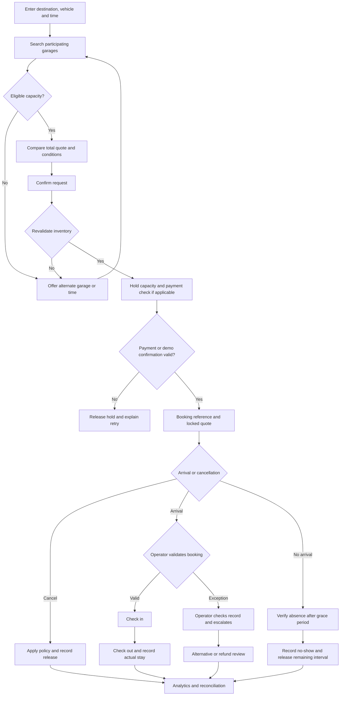

# A03 — Operational process flow · v0.1 · proposed
Scope: driver planning parking through departure. Current baseline demonstrates only map/list, local reservation and cancellation; interval validation, real payment and physical admission are not established.

Payment, holds, operator validation, exception handling and actual occupancy are proposed; no funds move in the demo. Local booking must remain usable when map rendering fails.
