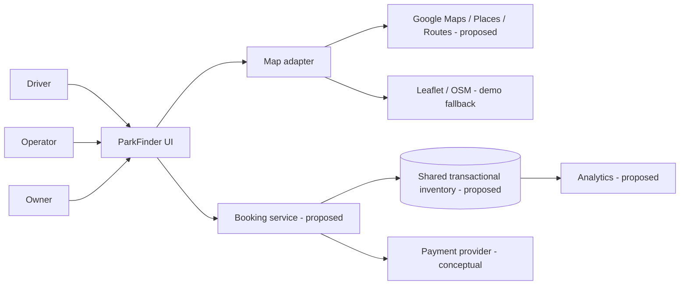

# A06 — System architecture · v0.1 · draft
## AS-IS
Browser → static HTML/CSS/JS → Leaflet/OSM + Nominatim; demo garage data and bookings in localStorage. No shared inventory, real payment or verified physical admission. Distance is an estimate, not a routed journey.
## TO-BE

ParkFinder owns participating garage capacity, restrictions, booking intervals, confirmed prices and operational events. Map discovery does not establish availability. Never reserve a non-participating garage merely because it appears in search. Keep provider-specific records separate; verify terms, attribution and retention before displaying Google content alongside another map.
## Provider decision
Google Maps is the target provider; Leaflet/OSM remains the demo fallback. First evaluate keyless external Maps URLs and eligibility for a restricted no-cost Maps Demo Key. Do not enable billing without approval. Google APIs with billing require restricted credentials and quota monitoring; budget alerts alone are not hard caps. If map provider fails, show list and demo locations, not invented routed distances; booking must not depend on map rendering.
Sources: https://developers.google.com/maps/documentation/urls/get-started ; https://developers.google.com/maps/documentation/javascript/get-api-key ; https://developers.google.com/maps/documentation/places/web-service/get-api-key .
