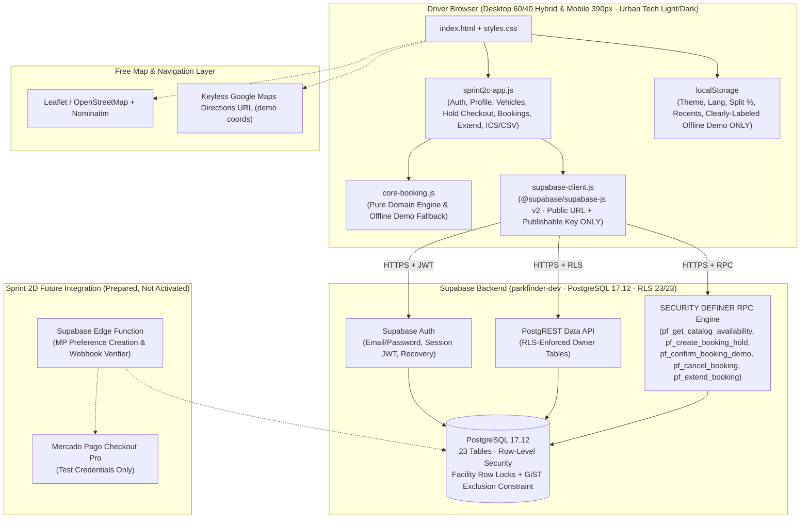
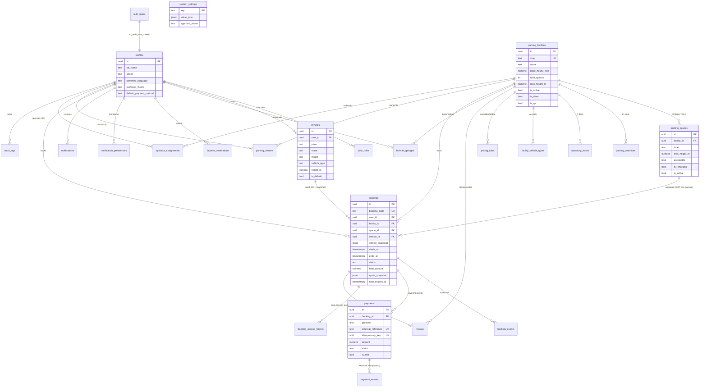

# parkFinder — Sprint 2C Architecture, ERD, Concurrency & Security Specification

- **Branch:** `feature/sprint-02c-supabase-backend`
- **Backend Platform:** Supabase Free Tier (`parkfinder-dev` / `qerrmfdpxbjwmeprwrbc` · PostgreSQL 17.12)
- **Frontend Hosting:** Static HTML/CSS/JS on Cloudflare Workers (zero build step, zero paid services)
- **Business Timezone:** `America/Argentina/Buenos_Aires` (UTC-3 fixed, no DST) · **DB Timezone:** `UTC`

---

## 1. System Architecture Diagram



### Source-of-Truth Separation
- **Centralized Supabase Mode (`backendMode = 'supabase'`):** PostgreSQL is the sole authority for catalog, capacity, holds, confirmed bookings, locked quotes, vehicles, favorites, profiles, notification preferences, and role permissions. `localStorage` stores only non-sensitive UI preferences (theme, language, split ratio, recent search terms) and the official Supabase Auth session token.
- **Offline Demo / QA Sandbox Mode (`backendMode = 'offline_demo'`):** Activated only when Supabase is unreachable or in isolated QA Sandbox mode. Visually distinguished by the `Demo Offline · Solo local` badge across the search bar, checkout modal, and booking records. Network errors during connected Supabase operations never silently confirm an offline booking as centralized.

---

## 2. Entity-Relationship Diagram (23 Tables)



---

## 3. Concurrency & Space Allocation Strategy (Anti-Overbooking)

Every capacity-mutating RPC (`pf_create_booking_hold`, `pf_confirm_booking_demo`, `pf_extend_booking`, `pf_cancel_booking`) enforces **three concentric layers of transactional protection**:

1. **Per-Facility Transactional Serialization:**
   - Executes `pg_advisory_xact_lock(hashtextextended(facility_id::text, 0))` AND `SELECT ... FROM public.parking_facilities WHERE id = p_facility_id FOR UPDATE`.
   - Concurrent transactions targeting the same garage queue cleanly at PostgreSQL's lock manager and release automatically upon `COMMIT`/`ROLLBACK` (zero lock leaks).
2. **Lazy Hold Expiration Inside the Critical Section (Zero-Cost Free Tier):**
   - Immediately calls `pf_expire_stale_holds_for_facility(facility_id)`, marking any `pending_payment` row with `hold_expires_at <= now()` as `status = 'expired'`, cancelling its pending payment, and recording a `hold_expired` event.
   - Guarantees expired temporary holds **never** consume capacity even without paid background schedulers.
   - Late confirmation attempts (`pf_confirm_booking_demo`) re-check `hold_expires_at > now()` under the facility lock and return `HOLD_EXPIRED` if elapsed, preventing overbooking.
3. **Concrete Space Assignment + PostgreSQL GiST Exclusion Constraint:**
   - Assigns an active physical `parking_spaces.id` matching `max_height_m` with no half-open `[starts_at, ends_at)` overlap.
   - Enforced at the storage/index layer by:
     ```sql
     ALTER TABLE public.bookings
       ADD CONSTRAINT bookings_no_overlapping_space
       EXCLUDE USING gist (
         space_id WITH =,
         tstzrange(starts_at, ends_at, '[)') WITH &&
       )
       WHERE (space_id IS NOT NULL AND status IN ('pending_payment', 'confirmed', 'checked_in'));
     ```
   - Even under extreme parallel load (verified with 10 simultaneous PostgreSQL sessions on a capacity-1 garage in `tests/pg_concurrency_and_parity_tests.js`), strictly 1 booking succeeds and 9 receive `NO_AVAILABILITY`.

---

## 4. Security Architecture & Least Privilege

- **RLS Enabled on 23/23 Public Tables** (`0` disabled).
- **Deny-by-Default Privileges:**
  - `authenticated` cannot `INSERT`/`UPDATE`/`DELETE` on `bookings`, `booking_events`, `payments`, `payment_events`, `booking_access_tokens`, `user_roles`, `audit_logs`, `parking_spaces`, `pricing_rules`, or `system_settings`.
  - `anon` cannot read any user, vehicle, booking, payment, token, or audit table.
  - `booking_access_tokens` stores only SHA-256 digests (`encode(digest(raw_token, 'sha256'), 'hex')`) and has zero direct client `SELECT`.
- **Hardened `SECURITY DEFINER` Functions:**
  - Every function locks `SET search_path = pg_catalog, public` (or `pg_catalog, public, extensions`), revokes `PUBLIC` execute, and grants `EXECUTE` strictly to `authenticated` (or `anon, authenticated` for read-only catalog/quote RPCs).
  - User identity is **always** derived from `auth.uid()`. Client-supplied prices, roles, statuses, and user IDs are never accepted.
- **Role Readiness:** `user_roles` supports `driver`, `operator`, `owner`, `admin` with internal helper `pf_has_role(user_id, role)`. Driver self-service is active in Sprint 2C; operator check-in/out and owner analytics RPCs are deferred to Sprint 3.

---

## 5. Mercado Pago Checkout Pro Architecture (Prepared for Sprint 2D)

- **Not Activated in Sprint 2C:** Zero real payments, zero card input fields, zero Access Tokens or private keys in frontend or GitHub.
- **Prepared Schema & Contract:**
  - `bookings.hold_expires_at` (10-min temporary hold), `bookings.booking_code` (maps 1:1 to `payments.external_reference`).
  - `payments.idempotency_key` (`UNIQUE`), `payments.external_reference` (`UNIQUE`), `payments.mp_preference_id`, `payments.mp_payment_id` (`UNIQUE`), `payments.is_test CHECK (is_test)` (locked to test mode during academic sprints).
  - `payment_events.provider_event_id` (`UNIQUE`), `payload_hash`, `raw_status`, `processed_at` for idempotent webhook ingestion.
  - **Sprint 2D Flow:** Browser requests preference from a Supabase Edge Function (holding MP Test Access Token as a server-only secret) → User pays in Mercado Pago Checkout Pro sandbox → MP sends webhook to Edge Function → Edge Function verifies payment status directly with Mercado Pago Payments API → Server transitions `payments.status = 'approved'` and `bookings.status = 'confirmed'` atomically under facility lock. Browser redirects NEVER confirm payments.
