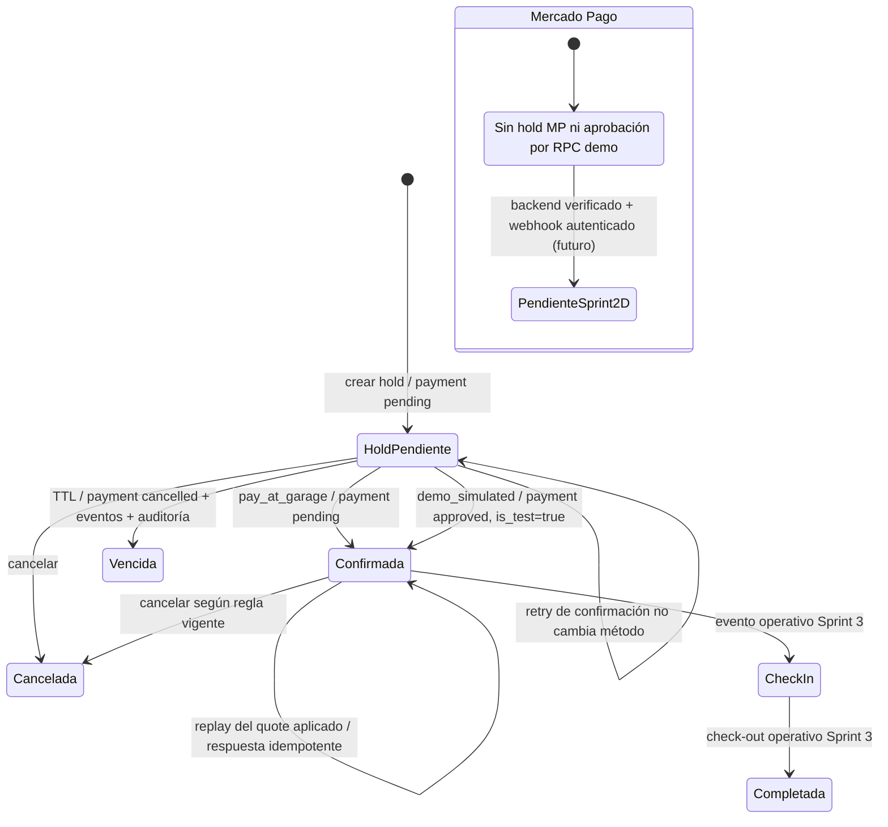

# Estados de reservas y pagos — Sprint 2C.1

Las cotizaciones de extensión tienen ciclo separado: `offered → applied`; pueden pasar a `expired` o `stale`. Una cotización vencida o cuyo precio cambió necesita una nueva cotización y aceptación. La falta de disponibilidad no altera la reserva original.
